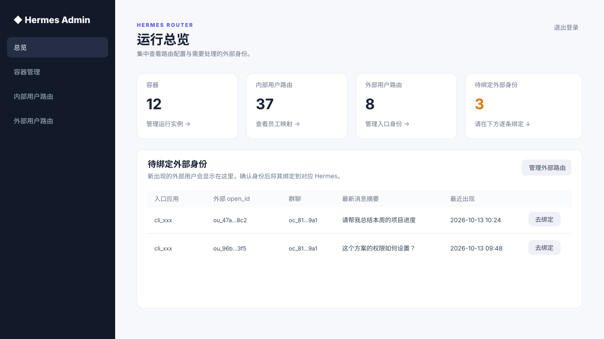
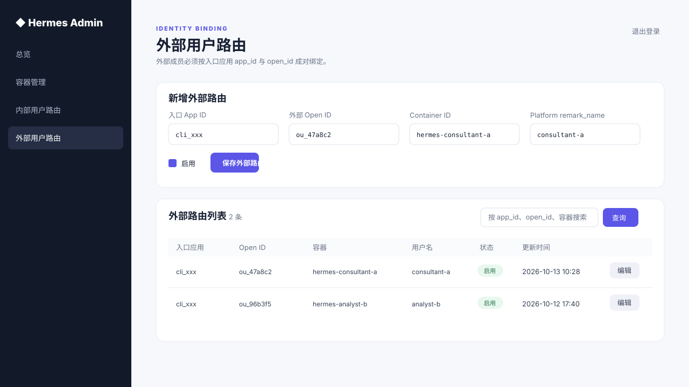

# Hermes Feishu Router

一个飞书消息路由器，服务每位成员独立的 AI 工作空间。

Hermes Feishu Router 会按消息发送者，将飞书机器人消息路由至对应员工专属的 Hermes 容器，并将回答回传到原私聊或群聊。成员不必知道容器地址或令牌；即使在同一个群里，彼此的 Agent、会话上下文和权限也保持隔离。

> 项目最初服务于 Ekko Studio，但不绑定 Ekko。任何兼容 `/chat-run` Socket.IO 对话协议的容器都可作为目标；Ekko Studio 只是 Hermes 容器的一种部署形态。

## 解决的问题

- **共享入口不串上下文**：团队只需维护一个或少量飞书机器人，不必为每位员工单独创建机器人。
- **群聊按提问者路由**：成员在同一群内 @ 机器人时，问题会进入其自己的 Hermes，而不是共用一个 Agent。
- **不暴露运行环境**：员工无需接触容器端口、地址或访问令牌。
- **管理员可控**：通过独立后台维护容器、内部成员路由和外部成员身份绑定，无需重启 Router。

## 适用场景

- 公司共用一个或多个飞书机器人；
- 员工拥有独立 Hermes 容器或 Agent 运行环境；
- 需要隔离不同员工、群聊和机器人之间的对话上下文；
- 不希望员工接触容器端口和令牌。

## 后台管理

`admin/` 是一个独立启动的轻量后台，与 Router 共用 MySQL，但不与 Router 进程耦合。管理员可以：

- 查看容器、内部用户路由、外部用户路由及待绑定身份数量；
- 管理内部员工 `user_id → Hermes 容器` 映射；
- 发现首次发消息的外部成员，确认后按 `app_id + open_id` 绑定专属 Hermes；
- 启用或停用路由，下一条消息立即生效。

下面图片使用脱敏演示数据，界面与内置后台模板一致。

### 运行总览与待绑定身份



### 外部成员路由绑定



后台的安装、登录和安全要求见 [admin/README.md](admin/README.md)。

## 架构

```text
飞书用户 / 群聊
       │ 每个机器人一条长连接
       ▼
┌─────────────────────────────────────┐
│ Hermes Feishu Router                 │
│ 身份识别 · 路由 · 会话 · 转发 · 回信 │
└──────────────┬──────────────────────┘
               │
     ┌─────────┴─────────┐
     ▼                   ▼
 MySQL                容器发现与鉴权提供者
 用户路由、会话、去重       ├─ 内置：Platform
                           └─ 可替换：静态配置 / CMDB / 自有 API
                                      │
                                      ▼
                          员工专属 Hermes 容器
                          /chat-run Socket.IO
                                      │
                                      ▼
                              回答发送到原 chat_id
```

Router 只负责“谁该访问哪个容器、如何建立和保持会话”；容器创建、运行状态和模型配置由外部系统负责。

## 路由与会话

```text
feishu_user_id ──> feishu_user_route ──> container_id、username

(app_id, feishu_user_id, chat_id)
         └──────────────> feishu_ekko_session ──> ekko_session_id
```

- `feishu_user_id`：飞书跨应用稳定的 `user_id`，用于人员路由。
- `app_id`：机器人所属飞书应用；同一员工在不同机器人中的上下文独立。
- `chat_id`：飞书私聊或群聊 ID，自动从事件取得。
- `ekko_session_id`：自动生成的目标会话 ID；目标容器不限定为 Ekko。

## 消息流程

1. 从飞书事件原始数据读取 `sender_id.user_id`、`chat_id` 与文本。
2. 查询 MySQL 路由，得到 `container_id` 与容器定位用的 `username`。
3. 容器发现与鉴权提供者解析目标地址和短期令牌。
4. 创建或恢复 `(app_id, user_id, chat_id)` 对应的目标会话。
5. 通过 Socket.IO `/chat-run` 转发问题，并把回答回发到原会话。

群聊消息会在服务端再次校验：只有飞书事件中明确标识为“@ 当前机器人”的消息才会转发；私聊消息则直接处理。因此即使应用被授予 `im:message.group_msg` 一类的群消息权限，普通群聊也不会触发 Hermes。

用户提问后会立即收到“正在处理”提示。开启流式时，回答以飞书 Card 2.0 的 Markdown 组件持续更新；关闭流式时，最终答案仍以 Card 2.0 发送。

## Platform：内置容器管理实现

`Platform` 不是飞书能力，也不是 Hermes 的强制组件。它是用于统一管理多个 Hermes 容器的自建平台：提供用户、容器端口、状态和外部 JWT 等信息。

内置解析流程：

```text
Platform /login
  → /api/hermes/users
  → username 匹配 remark_name
  → 取得 port 与 external_jwt
  → http://平台地址:port/api/auth/exchange-external-jwt
  → 获得目标容器的 Studio token
```

令牌只保留在单次请求内存中，不写入数据库或日志。

### 没有 Platform 怎么办？

可以。Platform 只是仓库内置的 `AccessResolver` 实现。没有它时，可手工维护用户—容器关系：

1. 在 `ekko_container` 和 `feishu_user_route` 中维护 `container_id`、`username` 和飞书 `user_id`；
2. 根据自己的部署方式实现 `username → {baseURL, token}` 的解析器；
3. 在 `cmd/server/main.go` 中用该解析器替换 `platform.NewAccessResolver(...)`。

静态配置、CMDB、Kubernetes API、内部 SSO 或其他管理 API 都可以作为数据源。解析器的输出契约为：

```go
model.StudioAccess{
    BaseURL: "http://hermes-host:port",
    Token:   "target-container-access-token",
}
```

仓库目前内置 Platform 解析器；没有提供通用静态解析器，因为不同 Hermes 部署的令牌签发方式不同。

## 配置

从 [config.yaml.example](config.yaml.example) 创建本地 `config.yaml`，不要将真实凭据提交到 Git。

```yaml
feishu:
  stream-enabled: true # false 时最终答案仍通过 Card 2.0 发送
  apps:
    - name: 主机器人
      app-id: cli_xxx
      app-secret: change-me

mysql:
  path: 127.0.0.1
  port: "3306"
  username: root
  password: change-me
  db-name: hermes_router
  config: charset=utf8mb4&parseTime=True&loc=Local

# 使用内置 Platform 解析器时需要配置。
platform:
  base-url: http://platform.example.internal
  username: platform-user
  password: change-me
```

每个飞书应用都需要独立 `app-id` / `app-secret`；Router 会为每个应用创建一条长连接。

## 初始化路由

首次启动自动创建 `ekko_container`、`feishu_user_route`、`feishu_ekko_session`、`feishu_event_dedup`。`ekko_container` 可存放任意 Hermes 兼容容器。

```sql
INSERT INTO ekko_container (container_id, profile)
VALUES ('hermes-user-a', 'default');

INSERT INTO feishu_user_route (feishu_user_id, container_id, username)
VALUES ('员工的 user_id', 'hermes-user-a', '员工或容器定位名');
```

使用内置 Platform 时，`username` 必须和 `/api/hermes/users` 返回项的 `remark_name` 完全一致。

路由表没有进程内缓存：运行时新增、修改或禁用路由，下一条消息立即生效。

## 启动与飞书配置

```bash
go run ./cmd/server
```

每个飞书应用需要：

- 启用“使用长连接接收事件/回调”；
- 订阅接收消息事件；
- 授予机器人收发消息、读取发送者 `user_id` 所需权限；
- 开启流式时授予 `im:message:update`；
- 不订阅未处理的 `im.message.message_read_v1` 已读事件，避免无害的 `not found handler` 日志。

使用 `Ctrl+C` 或 `SIGTERM` 可关闭长连接并退出。

## 独立后台管理

`admin/` 是独立启动的后台管理服务，使用单独登录配置并与 Router 共用 MySQL。它可维护容器、内部用户路由，以及外部成员的 `app_id + open_id` 路由；详见 [admin/README.md](admin/README.md)。
